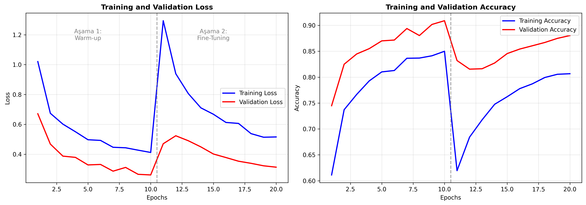
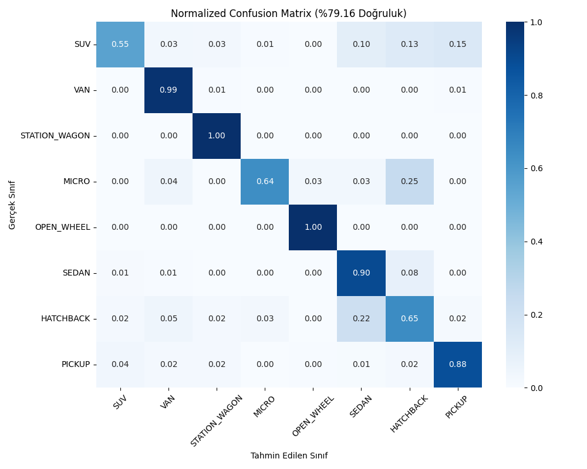

# 🚗 Araç Gövde Tipi Sınıflandırma

Bir araç fotoğrafından gövde tipini tahmin eden derin öğrenme modeli ve web arayüzü.
Model 8 sınıf arasından seçim yapar: **SUV, VAN, STATION WAGON, MICRO, OPEN WHEEL (açık tekerlekli), SEDAN, HATCHBACK, PICKUP**.

Kocaeli Üniversitesi Bilgisayar Mühendisliği, Yazılım Laboratuvarı II (Proje 3) kapsamında **Zeynep Akdağ** ve **Dilara Coşkun** tarafından geliştirilmiştir.

## Özellikler
- **Transfer öğrenme:** ImageNet üzerinde önceden eğitilmiş **EfficientNetB0**
- **İki aşamalı eğitim:** önce warm-up, ardından fine-tuning
- **Veri çoğaltma (augmentation):** döndürme, kaydırma, yakınlaştırma, yatay çevirme
- **Streamlit web arayüzü:** fotoğraf yüklenir, tahmin edilen sınıf, güven oranı ve tüm sınıfların olasılık grafiği gösterilir
- **Küçük model:** yaklaşık 33 MB, 4,4 milyon parametre

## Sonuçlar
Ölçümler doğrulama/test görüntüleri üzerinde yapılmıştır.

| Metrik | Değer |
|---|---|
| Doğruluk (Accuracy) | %79,16 |
| Ağırlıklı F1-Skoru | %79,05 |




VAN, OPEN WHEEL ve SEDAN sınıflarında başarı yüksek. Hatalar en çok birbirine benzeyen gövde tiplerinde yoğunlaşıyor: HATCHBACK ile SEDAN, MICRO ile HATCHBACK.

## Kurulum ve Çalıştırma
```bash
git clone https://github.com/ZeynepAkdag3/car-body-type-classification.git
cd car-body-type-classification
python -m venv venv
venv\Scripts\activate          # Linux/Mac: source venv/bin/activate
pip install -r requirements.txt
```

**Web arayüzü:**
```bash
streamlit run src/web_app.py
```
Ardından tarayıcıda http://localhost:8501 adresi açılır.

**Tek bir fotoğrafı komut satırından test etmek için:**
```bash
python src/test_model.py yol/araba.jpg
```

## Proje Yapısı
```
├── models/
│   ├── car_classification_model.h5   # Eğitilmiş model
│   └── class_mapping.json            # Sınıf numarası → isim
├── src/
│   ├── train_model.py    # Model eğitimi
│   ├── web_app.py        # Streamlit arayüzü
│   ├── test_model.py     # Tek görsel tahmini
│   ├── data_prep.py      # Veri seti klasör yapısı
│   ├── matris_ciz.py     # Karışıklık matrisi çizimi
│   └── grafik_ciz.py     # Eğitim grafikleri
├── reports/              # Grafikler
├── PredictionScript.txt  # Değerlendirme için istenen Predict() fonksiyonu
└── requirements.txt
```

## Veri Seti
Yaklaşık 5.600 görüntüden oluşur: 4.370 eğitim, 1.262 doğrulama. Görüntüler Google Görseller'den ve Kaggle'daki açık veri setlerinden derlenmiştir:
- [Cars Body Type Cropped](https://www.kaggle.com/datasets/ademboukhris/cars-body-type-cropped)
- [Stanford Car Body Type Data](https://www.kaggle.com/datasets/mayurmahurkar/stanford-car-body-type-data)

Veri seti boyutu ve telif hakları nedeniyle bu repoda yer almaz. Modeli yeniden eğitmek isterseniz görselleri `dataset/train/<SINIF>/` ve `dataset/validation/<SINIF>/` klasörlerine yerleştirip şu komutu çalıştırın:
```bash
python src/train_model.py
```

## Kullanılan Teknolojiler
Python · TensorFlow / Keras · EfficientNetB0 · scikit-learn · Streamlit · Matplotlib / Seaborn
